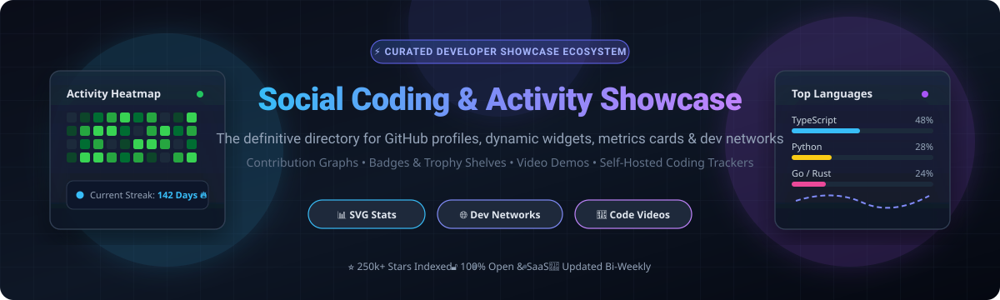

# Awesome Social Coding & Developer Activity Showcase 🚀🌟

<p align="center">
  
</p>

<p align="center">
  <a href="https://github.com/ishandutta2007/Awesome-Awesome-Awesome"></a>
  <a href="https://discord.gg/jc4xtF58Ve"></a>
  <a href="https://github.com/ishandutta2007/Awesome-Social-Coding-Developer-Activity-Showcase/stargazers"></a>
  <a href="https://github.com/ishandutta2007/Awesome-Social-Coding-Developer-Activity-Showcase/network/members"></a>
  <a href="https://github.com/ishandutta2007/Awesome-Social-Coding-Developer-Activity-Showcase/blob/main/LICENSE"></a>
  <a href="https://github.com/ishandutta2007"></a>
</p>

---

## 📖 Executive Summary & SEO Overview 🔍✨

Welcome to the definitive, SEO-optimized directory of **Social Coding Platforms & Developer Activity Showcase Ecosystems** 🌐💻. In modern software engineering, personal portfolios, GitHub profile READMEs, and dynamic contribution widgets serve as the interactive resumes and proof-of-work credentials for software developers, indie hackers, and open-source maintainers.

This index curates both high-performance commercial SaaS platforms and premier open-source repositories designed to:
- 📊 **Visualize Git Activity & Streaks**: Embed real-time SVG cards, commit calendars, 3D isometric cityscapes, and contribution snakes.
- 🏆 **Display Credential Badges & Digital Trophies**: Highlight verifiable skill badges, language proficiencies, and hackathon accomplishments.
- 🎥 **Programmatic Code-First Showcases**: Produce animated MP4 software demos and version-control git history animations natively from code.
- 🌍 **Developer Social Networks & Technical Storytelling**: Publish build logs, technical articles, and interact across developer feeds.

---

## 📊 Sector Overview & Market Dynamics 📈💡

The broader **Developer Tools, Portfolios & Community Engagement Software** market is currently estimated between **$2.4 Billion and $4.3 Billion**, forming an integral sub-segment of the **$260+ Billion Application Development Software ecosystem** which expands at a **Compound Annual Growth Rate (CAGR) of 21.4% to 22.8%** toward $1 Trillion by the early 2030s.

### 🧩 Market Dynamics:
- **Fragmentation Level**: **Moderately to Highly Fragmented**. While core git hosting and identity are anchored by mega-platforms like Microsoft/GitHub and GitLab, the showcase, portfolio, and social layer is heavily dispersed across thousands of agile point-solutions, specialized developer blogging platforms, and open-source widgets.
- **Winner-Take-Most vs. Open Sovereignty**: Network effects create strong regional and topical community hubs (such as DEV, Hashnode, and daily.dev), yet open-source, self-hosted alternatives (like Wakapi, Forem, and self-hosted SVG card generators) maintain continuous grassroots adoption due to developer insistence on data ownership, privacy, and zero vendor lock-in.

---

## 📑 Table of Contents 🧭

- [📖 Executive Summary & SEO Overview](#-executive-summary--seo-overview-)
- [📊 Sector Overview & Market Dynamics](#-sector-overview--market-dynamics-)
- [☁️ SaaS / Hosted Developer Showcase Platforms](#️-saas--hosted-developer-showcase-platforms-)
- [💻 Open-Source GitHub Projects](#-open-source-github-projects-)
- [🛠️ Architectural Blueprints & Stacks](#️-architectural-blueprints--stacks-)
- [🤝 How to Contribute](#-how-to-contribute-)
- [💖 Support & Star History](#-support--star-history-)
- [⚖️ Disclaimer](#️-disclaimer-)

---

## ☁️ SaaS / Hosted Developer Showcase Platforms ☁️🏢

Commercial platforms and hosted developer showcase services, ranked in descending order by **Company Valuation / Revenue Scale** 💼📉:

| 🏢 Platform | 💰 Company Valuation / Revenue Scale | 🏷️ Starting Paid Tier | 🎁 Free Tier Limits & Trial Specifications | 🌟 Key Strengths & Showcase Capabilities |
| :--- | :--- | :--- | :--- | :--- |
| **[Polywork](https://polywork.com)** | **$44.5M Total Raised** *(Series B backed by Nat Friedman & a16z)* | **$12 / month** *(VIP / Creator Plan)* | **Free Forever Plan**: Full personal timeline profile, multi-project showcase, badges, and up to 3 outbound badge links with standard directory discovery. | Multidisciplinary professional timeline and project showcase allowing engineers and creators to highlight side-projects, talks, and open-source collabs without standard resume constraints. 🎨💼 |
| **[DEV / Forem](https://dev.to)** | **$12.4M Total Raised** *(Series A backed by Mayfield; ~$5M+ ARR scale)* | **$90 / month** *(Forem Cloud Pro Managed)* | **Free Forever**: Unlimited articles, public profile portfolio, community comments, RSS feeds, and social discussions with zero paywalls. | Global developer blogging and social coding network with millions of active engineers publishing tutorials, release logs, and project milestones. 📝🌐 |
| **[Daily.dev](https://daily.dev)** | **$11.0M Total Raised** *(Seed round led by Aleph; ~$4.2M estimated run-rate)* | **$14.99 / month** *(daily.dev Plus; or $89.99/year)* | **Free Forever**: Unlimited developer feed access, new-tab extensions, mobile apps, Squads discussions, and developer profile showcase (ad-supported). | Personalized engineering news aggregator, developer feed, and community reputation hub connecting engineers with curated articles and peer discussions. 📰⚡ |
| **[Hashnode](https://hashnode.com)** | **$8.8M Total Raised** *(Series A led by Salesforce Ventures & Sequoia Surge)* | **$5.00 / month / seat** *(Hashnode Pro; $50/year)* | **Free Forever**: Unlimited technical articles and readers on a `*.hashnode.dev` subdomain, Markdown editor, syntax highlighting, and basic analytics. *(Custom domain requires Pro)*. | Modern developer blogging and technical publication platform offering native Markdown support, series, and developer portfolio pages. ✍️🚀 |
| **[Showwcase](https://showwcase.com)** | **$2.5M Estimated Raised** *(Seed round led by Init-6, Blockarm Capital)* | **$199 / month** *(Showwcase Recruit Starter for hiring teams)* | **Free Forever for Developers**: Unlimited project showcases, technical threads, custom developer profile, credentials, and code repository links. | Social network engineered specifically for developers to showcase live code repositories, tech stack cards, technical threads, and verifiable engineering work history. 💻🤝 |
| **[WakaTime](https://wakatime.com)** | **~$660k ARR** *(Profitable bootstrapped SaaS; small agile team)* | **$9.00 / month** *(Premium Plan; or $14/month billed monthly)* | **Free Forever Plan**: Automatic time tracking across all supported IDEs, language breakdowns, but dashboard analytics history is limited to the last **14 days**. | Cloud-hosted developer productivity dashboard and IDE plugin ecosystem providing automated coding metrics, language breakdowns, and embeddable profile badges. ⏱️📊 |
| **[Holopin](https://holopin.io)** | **Bootstrapped / Early Stage** *(Independent SaaS by Elena Lape)* | **$19.00 / month** *(Starter Issuer Plan for organizations)* | **Free Forever for Recipients**: Unlimited badge collecting, profile trophy board, and GitHub SVG embeds. Open-source maintainers can issue up to **10 unique badges/year** for free. | Verifiable digital badge and achievement showcase platform tailored for open-source maintainers, hackathons, and developer communities to award embeddable profile pins. 🏅🎖️ |
| **[GitSpo](https://gitspo.com)** | **Independent / Bootstrapped** *(Founded by Gajus Kuizinas)* | **$29.00 / month** *(Team / Commercial Open-Source Alerts)* | **Free Forever for Personal Use**: Full tracking of own public repositories, star history tracking, and standard community mention alerts. | GitHub profile analytics and developer discovery service highlighting contributor reach, star velocity, and open-source repository traction across social channels. 📈🔎 |

---

## 💻 Open-Source GitHub Projects 💻⭐

Curated open-source repositories for building custom profile READMEs, generating animated contribution visuals, rendering status badges, and tracking coding analytics. 

Ranked in descending order by **GitHub Stargazer Count** 🌟📉 (each badge links directly to stargazers):

| 📦 Project & Repository | 🌟 Star Count | 💻 Tech Stack | 🎯 Description & Feature Highlights |
| :--- | :--- | :--- | :--- |
| **[GitHub Readme Stats](https://github.com/anuraghazra/github-readme-stats)** | [](https://github.com/anuraghazra/github-readme-stats/stargazers) | JavaScript, NodeJS, SVG | Dynamically generated SVG cards for GitHub READMEs displaying overall stats, streak metrics, top programming languages, and pinned repo highlights. ⚡📊 |
| **[Remotion](https://github.com/remotion-dev/remotion)** | [](https://github.com/remotion-dev/remotion/stargazers) | TypeScript, React, WebAssembly | Programmatically create MP4 launch videos, dynamic coding walkthroughs, and animated data visualizations using standard React web components. 🎥✨ |
| **[Awesome GitHub Profile README](https://github.com/abhisheknaiidu/awesome-github-profile-readme)** | [](https://github.com/abhisheknaiidu/awesome-github-profile-readme/stargazers) | Markdown, Resources | A curated catalog of exceptional, creative, and dynamically updating GitHub profile READMEs for developer inspiration and layout ideas. 😎📑 |
| **[Shields.io](https://github.com/badges/shields)** | [](https://github.com/badges/shields/stargazers) | JavaScript, Node.js, SVG | Concise, consistent, and legible SVG/PNG metadata badges for CI/CD builds, code coverage, licenses, package downloads, and social links. 🛡️🏷️ |
| **[GitHub Profile Readme Generator](https://github.com/rahuldkjain/github-profile-readme-generator)** | [](https://github.com/rahuldkjain/github-profile-readme-generator/stargazers) | JavaScript, Vue.js | Intuitive web interface to generate clean, expressive GitHub profile READMEs complete with skill badges, dynamic cards, and social icons. 🚀🎨 |
| **[Forem](https://github.com/forem/forem)** | [](https://github.com/forem/forem/stargazers) | Ruby on Rails, Preact, PostgreSQL | Open-source software powering Dev.to and independent social networks designed specifically for developer communities and engineering publications. 🌱🤝 |
| **[Metrics](https://github.com/lowlighter/metrics)** | [](https://github.com/lowlighter/metrics/stargazers) | JavaScript, Node.js, SVG | Infographics generator with 40+ plugins and 300+ options rendering GitHub activity, music habits, isometric calendars, LeetCode, and WakaTime stats. 📊🔮 |
| **[Skill Icons](https://github.com/tandpfun/skill-icons)** | [](https://github.com/tandpfun/skill-icons/stargazers) | SVG, JavaScript | Showcase software engineering skills on GitHub READMEs or online resumes with beautiful, clean, dark/light mode compatible tech-stack icons. ✨🛠️ |
| **[Gource](https://github.com/acaudwell/Gource)** | [](https://github.com/acaudwell/Gource/stargazers) | C++, OpenGL, SDL | Software version control visualizer that animates git repositories as an organic tree where contributors interact with files in real time. 🌳🎬 |
| **[Devicon](https://github.com/devicons/devicon)** | [](https://github.com/devicons/devicon/stargazers) | SVG, CSS, Font | Vast collection of developer logos and icons representing programming languages, design suites, frameworks, and dev tools in font and vector SVG. 🔣🎨 |
| **[Readme Typing SVG](https://github.com/DenverCoder1/readme-typing-svg)** | [](https://github.com/DenverCoder1/readme-typing-svg/stargazers) | PHP, SVG, CSS | Dynamically generated, customizable SVG animation providing a typewriter text effect for GitHub profile headers and repository descriptions. ⌨️💫 |
| **[GitHub Readme Streak Stats](https://github.com/DenverCoder1/github-readme-streak-stats)** | [](https://github.com/DenverCoder1/github-readme-streak-stats/stargazers) | PHP, SVG | Stay motivated and showcase consistency with dynamic SVG cards displaying current contribution streak, longest streak, and total contributions. 🔥📅 |
| **[GitHub Profile Trophy](https://github.com/ryo-ma/github-profile-trophy)** | [](https://github.com/ryo-ma/github-profile-trophy/stargazers) | TypeScript, SVG | Dynamic SVG trophy shelf that evaluates GitHub metrics and awards rank trophies across commits, stars, followers, issues, and PR reviews. 🏆🥇 |
| **[GitHub Contribution Snake (snk)](https://github.com/Platane/snk)** | [](https://github.com/Platane/snk/stargazers) | TypeScript, GitHub Actions | Generates an animated snake game eating user GitHub contribution calendar squares, outputting directly to animated SVG or GIF. 🟩🐍 |
| **[Awesome Profile README Templates](https://github.com/durgeshsamariya/awesome-github-profile-readme-templates)** | [](https://github.com/durgeshsamariya/awesome-github-profile-readme-templates/stargazers) | Markdown, HTML | Ready-to-use, responsive profile README templates with embedded stats cards, social badges, and dynamic project showcase grids. 📋📐 |
| **[GitHub Profile Views Counter](https://github.com/antonkomarev/github-profile-views-counter)** | [](https://github.com/antonkomarev/github-profile-views-counter/stargazers) | PHP, SVG | Minimalist SVG badge counter that tracks profile visits and views across GitHub accounts with zero JavaScript required. 👁️📈 |
| **[Readme.so](https://github.com/octokatherine/readme.so)** | [](https://github.com/octokatherine/readme.so/stargazers) | TypeScript, Next.js, TailwindCSS | Elegant browser-based drag-and-drop editor with pre-built Markdown sections and live preview for creating project and developer READMEs in seconds. 📝🖥️ |
| **[Wakapi](https://github.com/muety/wakapi)** | [](https://github.com/muety/wakapi/stargazers) | Go, SQLite/Postgres | Minimalist, self-hosted WakaTime-compatible backend written in Go for tracking personal IDE coding statistics and generating private SVG badges. ⏱️🔒 |
| **[Isometric Contributions](https://github.com/jasonlong/isometric-contributions)** | [](https://github.com/jasonlong/isometric-contributions/stargazers) | JavaScript, Chrome Extension | Renders an isometric pixel-art 3D cityscape of a GitHub user's commit history directly in place of the standard 2D contribution calendar. 🏙️🧱 |
| **[GitHub Profile Summary Cards](https://github.com/vn7n24fzkq/github-profile-summary-cards)** | [](https://github.com/vn7n24fzkq/github-profile-summary-cards/stargazers) | Java, GitHub Actions | GitHub Action generating 6+ themed profile cards summarizing commit distribution across time of day, day of week, languages, and repo stars. 🗂️📊 |
| **[Blog Post Workflow](https://github.com/gautamkrishnar/blog-post-workflow)** | [](https://github.com/gautamkrishnar/blog-post-workflow/stargazers) | Python, GitHub Actions | Automated GitHub Action that pulls latest blog posts from Dev.to, Hashnode, Medium, Substack, or RSS feeds and injects them into READMEs. 🔄📰 |
| **[GitHub Readme Activity Graph](https://github.com/Ashutosh00710/github-readme-activity-graph)** | [](https://github.com/Ashutosh00710/github-readme-activity-graph/stargazers) | JavaScript, Node.js, SVG | Dynamically generated SVG activity line chart showcasing a developer's last 31 days of GitHub contributions with customizable color palettes. 📈📉 |
| **[GitHub Profile 3D Contrib](https://github.com/yoshi389111/github-profile-3d-contrib)** | [](https://github.com/yoshi389111/github-profile-3d-contrib/stargazers) | JavaScript, GitHub Actions | Action that calculates commit counts and renders a photorealistic 3D bar graph calendar embedded directly in your GitHub profile README. 🧊📊 |

---

## 🛠️ Architectural Blueprints & Stacks 🏗️⚙️

To build an automated, professional developer profile showcase with zero manual overhead:

```
┌───────────────────────────────────────────────────────────────────┐
│                    Developer Identity Pipeline                    │
│                 (GitHub Actions Scheduled Cron)                   │
└─────────────────────────────────┬─────────────────────────────────┘
                                  │
         ┌────────────────────────┼────────────────────────┐
         │                        │                        │
         ▼                        ▼                        ▼
┌──────────────────┐    ┌──────────────────┐    ┌──────────────────┐
│   Activity &     │    │ Dynamic Content  │    │  Proof of Work   │
│   Commit Stats   │    │  Blog Sync / RSS │    │  Badges & Pins   │
│                  │    │                  │    │                  │
│ • metrics        │    │ • blog-post-     │    │ • shields.io     │
│ • streak-stats   │    │   workflow       │    │ • skill-icons    │
│ • snk (snake)    │    │ • Dev.to /       │    │ • holopin badges │
│ • wakapi         │    │   Hashnode RSS   │    │ • trophy shelf   │
└──────────────────┘    └──────────────────┘    └──────────────────┘
```

- **Core Activity Showcase**: Combine **lowlighter/metrics** with **DenverCoder1/github-readme-streak-stats** to display verified commit streaks and multi-language metrics.
- **Dynamic Content Ingestion**: Utilize **gautamkrishnar/blog-post-workflow** to automatically syndicate your technical writing from Hashnode and Dev.to into your profile Markdown.
- **Visual Polish**: Use **tandpfun/skill-icons** for uniform tech badges and **octokatherine/readme.so** to structure sections cleanly.
- **Motion Showcases**: Leverage **remotion-dev/remotion** or **acaudwell/Gource** to create high-framerate demo videos for repository launches.

---

## 🤝 How to Contribute 🤝💡

Contributions, additions, and updates are warmly welcomed! 🌟

1. **Fork** the repository to your account.
2. **Add / Edit** listings in `README.md` following the established table structure.
   - For SaaS listings: include specific starting tier pricing, explicit free-tier limits, and company scale.
   - For Open-Source listings: include an official GitHub repo with a `style=social&color=white` star badge linking to the `/stargazers` page, and sort descending by star count.
3. **Submit a PR** with a concise description of your additions.

---

## 💖 Support & Star History ⭐📈

If you find this showcase directory useful, please consider giving it a star! 🌟

[](https://star-history.com/#ishandutta2007/Awesome-Social-Coding-Developer-Activity-Showcase&Date)

---

## ⚖️ Disclaimer 📌⚠️

- This is a community-curated directory compiled for educational, architectural, and discovery purposes. Inclusion does not imply official commercial endorsement.
- Ensure that GitHub Personal Access Tokens (PATs) used with automated Actions have minimal read scopes (`read:user`) and are never exposed in public repositories.
- Self-hosted card renderers (e.g., `github-readme-stats`, `metrics`) can encounter GitHub API rate-limiting; deploying your own Vercel or Docker instance is recommended for high-volume profiles.

---

<p align="center">
  <sub>Built with ❤️ for software engineers, open-source maintainers, and developer advocates worldwide.</sub>
</p>
